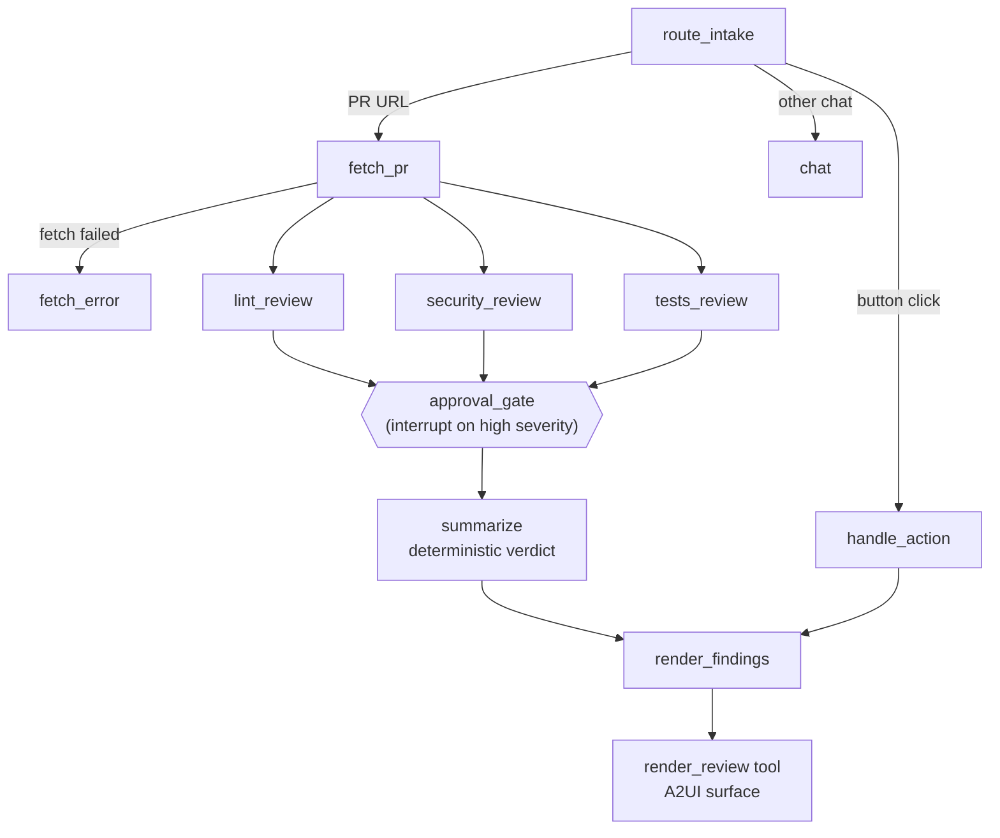

# review-deck

A PR-review agent built on CopilotKit and LangGraph. Paste a GitHub PR URL and three LLM reviewers (lint, security, tests) run in parallel over the line-numbered diff. High-severity findings pause the graph for your approval. Findings then render as cards where you can **Apply fix**, which posts a GitHub `suggestion` review comment, or **Dismiss**. A live graph panel shows which node is running.

## Architecture



- `agent/` is the Python LangGraph agent, served over AG-UI by FastAPI on port 8123.
- `src/` is the Next.js 16 frontend (CopilotKit 1.79). `/api/copilotkit` proxies to the agent.
- A2UI schemas are in `agent/src/a2ui/schemas/`. The matching React catalog is in `src/app/declarative-generative-ui/`.
- The approval form uses `interrupt()`. The run resumes from the checkpoint once you submit your decisions.
- The active thread lives in the URL (`?thread=`), so a reload reconnects to the same review.

## Prerequisites

- Node 20+
- Python 3.12+
- [uv](https://docs.astral.sh/uv/)

## Setup

```bash
npm install            # also runs `uv sync` in agent/
cp .env.example .env
```

Edit `.env`:

| Variable | Notes |
| --- | --- |
| `OPENAI_API_KEY` | Required (for the default model). |
| `COPILOTKIT_AGENT_MODEL` | Optional, `<provider>:<model>` (openai, anthropic, google). Default `openai:gpt-5.4`. Set the matching provider key for non-OpenAI models. |
| `GITHUB_TOKEN` | Fine-grained token with Pull requests read/write and Contents read. Needed for private repos and for Apply fix. Public PRs can be reviewed without it, but rate-limited. |
| `CPK_INTELLIGENCE_API_KEY` etc. | Optional. Enables the CopilotKit Intelligence threads drawer. Without it, an in-memory runner is used. |

## Run

```bash
npm run dev
```

UI at http://localhost:3000, agent at http://localhost:8123. Startup prints warnings for missing keys.

## Usage

1. Send `Review https://github.com/psf/requests/pull/6710` (or click a suggestion pill).
2. Watch the graph panel (App mode) as the reviewers run.
3. If there are high-severity findings, an approval form appears. Approve or reject each one, then submit.
4. Read the summary (with a verdict: Approve, Approve with nits, or Request changes) and the finding cards.
5. **Apply fix** posts a suggestion comment on the PR. **Dismiss** hides the finding.
6. **New review** starts a fresh thread.

## Tests

```bash
cd agent && uv run pytest
```

## Known limitations

- State is checkpointed in memory (`MemorySaver`). Restarting the agent loses threads and pending approvals.
- Reviews vary from run to run because they come from LLMs.
- Suggestions are single-line replacements.
- After Apply fix or Dismiss, the result re-renders as a new compact surface rather than updating the card in place.
- Chat messages typed while the approval form is open are ignored.

## License

MIT, inherited from the CopilotKit + LangGraph starter this project was based on. See [LICENSE](LICENSE).
