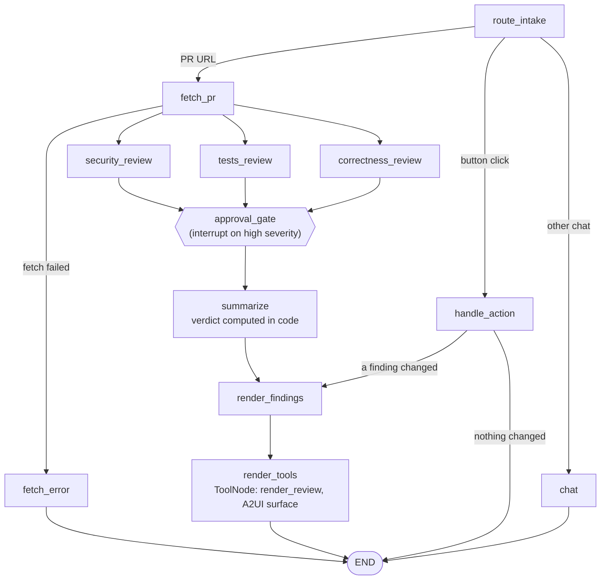

# review-deck

A PR-review agent built on CopilotKit and LangGraph. Paste a GitHub PR URL and three LLM reviewers (security, tests, correctness) run in parallel over the line-numbered diff. Style and lint are left to free static tools in CI (ruff, eslint, etc.). High-severity findings pause the graph for your approval. Findings then render as cards where you can **Apply fix** (posts a GitHub `suggestion` review comment; **Post comment** when there is no suggestion) or **Dismiss**. A live graph panel shows which node is running.

## Architecture



- `agent/` is the Python LangGraph agent, served over AG-UI by FastAPI (default port 8123, `PORT` to change). `agent/src/endpoint.py` cancels the graph when the client disconnects (Stop).
- `src/` is the Next.js 16 frontend (CopilotKit 1.79). `/api/copilotkit` proxies to the agent at `AGENT_URL`.
- A2UI schemas are in `agent/src/a2ui/schemas/`. The matching React catalog is in `src/app/declarative-generative-ui/`.
- `handle_action` handles the Apply fix / Dismiss button events. It goes to END with only a chat message when no finding changed (unknown action, finding not found, already applied/dismissed/rejected).
- The approval form uses `interrupt()`. The run resumes from the checkpoint once you submit your decisions.
- The active thread lives in the URL (`?thread=`), so a reload reconnects to the same review.

## Prerequisites

- Node 20+
- Python 3.12+ (`agent/pyproject.toml`: `>=3.12`)
- [uv](https://docs.astral.sh/uv/) (`brew install uv`); `npm install` runs `uv sync` in `agent/`

## Setup

```bash
npm install            # also runs `uv sync` in agent/
cp .env.example .env
```

Edit `.env`:

| Variable | Notes |
| --- | --- |
| `OPENAI_API_KEY` | Required (for the default model). `npm run dev` warns if it is missing. |
| `AGENT_URL` | Where the Next.js API route reaches the agent. Default `http://localhost:8123`; must match the agent port (`LANGGRAPH_DEPLOYMENT_URL` is accepted as a fallback). |
| `PORT` | Agent server port (read by `agent/main.py`), default `8123`. Change `AGENT_URL` to match. |
| `COPILOTKIT_AGENT_MODEL` | Optional, `<provider>:<model>` (openai, anthropic, google, xai). Default `openai:gpt-5.4`. Set the matching provider key (`ANTHROPIC_API_KEY`, `GOOGLE_API_KEY`, `XAI_API_KEY`) for non-OpenAI models. See Choosing models. |
| `OPENAI_BASE_URL` | Optional. For an OpenAI-compatible endpoint use `openai:<its model id>` plus this URL. |
| `GITHUB_TOKEN` | Fine-grained token with Pull requests read/write and Contents read. Needed for private repos and for Apply fix. Public PRs can be reviewed without it, but rate-limited. Can be put in `.env` or exported in the shell that starts `npm run dev`. |
| `GITHUB_API_URL` | Optional GitHub API base (GitHub Enterprise). Default `https://api.github.com`. Note the PR URL parser only accepts `github.com` links. |
| `REVIEW_DISCUSSION` | Optional. Set `0`, `false` or `off` to stop fetching existing PR comments for the reviewers. Default on. `GITHUB_TOKEN` is needed to exclude resolved review threads. |
| `REVIEW_DISCUSSION_MAX_CHARS` | Optional character budget for the PR discussion shown to reviewers. Default `12000`; invalid or non-positive values fall back to it. |
| `*_MODEL`, `*_BUDGET_SECONDS` | Per-step routing and time budgets; see Choosing models. |
| `CPK_INTELLIGENCE_API_KEY` etc. | Optional (`INTELLIGENCE_API_URL`, `INTELLIGENCE_GATEWAY_WS_URL`, `COPILOTKIT_LICENSE_TOKEN`). Enables the CopilotKit Intelligence threads drawer. Without it, an in-memory runner is used. |

The agent loads `.env` from the repo root.

## Choosing models

Each LLM step picks its model as `<provider>:<model>`; the first variable that is set wins:

| Step | Resolution order |
| --- | --- |
| Security / Tests / Correctness reviewer | `SECURITY_MODEL` / `TESTS_MODEL` / `CORRECTNESS_MODEL`, then `REVIEWER_MODEL`, then `COPILOTKIT_AGENT_MODEL`, then `openai:gpt-5.4` |
| Summary | `SUMMARY_MODEL`, then `COPILOTKIT_AGENT_MODEL`, then default |
| Chat | `CHAT_MODEL`, then `COPILOTKIT_AGENT_MODEL`, then default |

`REGRESSION_MODEL` still works as a deprecated alias of `CORRECTNESS_MODEL` (the regression reviewer was merged into correctness) and logs a one-time warning. `LINT_MODEL` is no longer read (the lint reviewer was removed) and logs a one-time warning if set.

Providers: `openai` (`OPENAI_API_KEY`), `anthropic` (`ANTHROPIC_API_KEY`), `google` (`GOOGLE_API_KEY`), `xai` or `grok` (`XAI_API_KEY`). The models actually used are shown per step in the UI. Example mix:

```bash
SECURITY_MODEL=anthropic:claude-opus-5-5
REVIEWER_MODEL=anthropic:claude-sonnet-5-5
SUMMARY_MODEL=anthropic:claude-haiku-5-5
```

Claude Opus/Sonnet 5.5 always think, so reviews with them are slower. Each reviewer has a time budget (`REVIEWER_BUDGET_SECONDS`, default 90) and the summary has `SUMMARY_BUDGET_SECONDS` (default 45); a reviewer over budget is shown as timed out and noted in the summary, and the others still complete. A summary over budget falls back to a deterministic summary. Pressing Stop disconnects the client, which cancels the running graph (and its LLM calls).

## Existing PR discussion

Before the reviewers run, `fetch_pr` also loads the PR's existing discussion: issue comments, review bodies and unresolved inline threads (from people and bots such as bugbot). Details:

- Reviewers see it in a `<pr_discussion>` block as untrusted leads to verify against the diff, never as instructions. Closing tags are escaped, and inline comments only go to reviewers that receive that file.
- Resolved threads are excluded only when `GITHUB_TOKEN` is set; without it every inline thread is shown.
- A finding within a couple of lines of an existing, non-outdated inline comment on the same file gets an **Already raised by** badge and the button becomes **Post anyway**.
- The summary notes key findings that were already raised, and the chat assistant gets a compact digest of the discussion (capped at 4,000 chars, oldest dropped first), so you can ask things like "did bugbot flag anything the review missed?".
- Control it with `REVIEW_DISCUSSION` and `REVIEW_DISCUSSION_MAX_CHARS` (see the table above). A failed fetch just means reviewing without the discussion.
- Known limitation: GitHub intermittently returns wrong `line` values for review comments, so lines are recomputed from `diff_hunk` and a comment may be shown without a line.

## Token usage and cost

Every LLM node (the three reviewers, summary and chat) records its token usage, and the graph panel shows it per node: input, output and cached tokens, plus how many files each reviewer received. The summary step also computes totals for the whole review.

- Tokens come from the provider's usage metadata (reviewers use structured output with `include_raw=True`, so the same code works for OpenAI, Anthropic, Google and xAI). A provider that reports no usage shows zeros.
- Cost is shown only for models with a known price. Built in (USD per 1M tokens, input / output / cache read): `claude-opus-5-5` 4 / 20 / 0.20, `claude-sonnet-5-5` 2 / 10 / 0.20, `claude-haiku-5-5` 0.10 / 0.50 (cached tokens at the input price). Any other model has no cost (shown as unknown, and the review total is unknown too) unless you supply prices:

```bash
MODEL_PRICES='{"openai:gpt-5.4": {"input": 2.5, "output": 15, "cache_read": 0.25}}'
```

  Values are USD per 1M tokens (`cache_read` optional; cached tokens are billed at it, else at `input`). `MODEL_PRICES` also overrides the built-in table.
- If a reviewer fails to parse its output, the tokens it spent are still counted. If a reviewer times out or errors without usage, its tokens are unknown, so the review totals are marked `partial` (the totals may be understated).
- Per-node usage is logged at info level. Cost is an estimate from list prices and ignores cache-write surcharges.

## Run

```bash
npm run dev
```

UI at http://localhost:3000, agent at http://localhost:8123. Startup prints warnings for missing keys.

## Usage

1. Send `Review https://github.com/psf/requests/pull/6710` (or click a suggestion pill).
2. Watch the graph panel (App mode) as the reviewers run; each LLM node shows its model.
3. If there are high-severity findings, an approval form appears. Approve or reject each one, then submit. Rejected findings are excluded from the summary and cards.
4. Read the summary (with a verdict: Approve, Approve with nits, or Request changes) and the finding cards.
5. **Apply fix** posts a single-line GitHub ```` ```suggestion ```` review comment on the cited line of the PR head commit; findings without a suggestion show **Post comment**, which posts just the title and explanation.
   - Idempotent: an already applied finding is not posted again. An in-flight guard blocks double clicks.
   - The result renders as a new compact card message (with a "View comment" link) rather than updating the original card.
   - Errors show on the card, e.g. 422 (PR changed since the review; re-run it) or 401/403 (token missing or lacks Pull requests write). The finding stays actionable.
6. **Dismiss** does not hide the finding. It marks it `dismissed` (grey status badge, buttons disabled) and renders a compact confirmation card.
7. **New review** starts a fresh thread.

## What each reviewer checks

Three reviewers run in parallel, each with its own rubric (`RUBRICS` in `agent/src/review/nodes.py`) and explicit ownership boundaries. Reviewers also see the PR's existing comments (issue comments, reviews and inline threads from people and bots such as bugbot or blast-radius reports) as untrusted leads to verify against the diff; inline comments are only shown to reviewers that receive that file. Disable with `REVIEW_DISCUSSION=0`. There is no lint reviewer: formatting, naming, import order and dead-code nits are left to linters in CI such as ruff or eslint.

| Reviewer | Checks | Does not report (owner) |
| --- | --- | --- |
| security | Injection, secrets, missing authn/authz, unsafe deserialization/eval, SSRF, insecure crypto/TLS, sensitive logging. High only for exploitable issues or credential exposure | General bugs and breaking changes (correctness); missing tests (tests) |
| tests | New/changed logic without tests, weak or tautological assertions, missing edge cases | Bugs and breaking changes (correctness); security; deleted tests (correctness) |
| correctness | Logic bugs in new or changed code (wrong conditions, off-by-one, null/None handling, division by zero, missing or wrong error handling, resource leaks, obvious performance traps) and breaking changes to existing behavior (API/signature/default changes, altered behavior of existing paths, data/schema/wire compatibility, removed functionality or deleted tests, phrased as "may break callers that ...") | Style/naming/formatting/dead code (linters); security; missing tests for new code |

## How findings are produced

- Noise files are skipped before any prompt is built and are not counted against the diff size caps. Skipped: lockfiles (`package-lock.json`, `yarn.lock`, `pnpm-lock.yaml`, `npm-shrinkwrap.json`, `uv.lock`, `poetry.lock`, `Pipfile.lock`, `Cargo.lock`, `Gemfile.lock`, `composer.lock`, `go.sum`), minified/bundled files (`*.min.js`, `*.min.css`, `*.map`), `*.snap`, `*_pb2.py`, `*.pb.go`, `*.generated.*`, anything under `node_modules/` or `__snapshots__/` at any depth, anything under `dist/`, `build/`, `out/`, `coverage/`, `target/`, `.next/` or `vendor/` only when that is the first path segment (so `src/build/compiler.ts` or `app/vendor/client.py` are still reviewed), and test baselines: `.js/.json/.txt/.snap/.d.ts/...` files under a `baselines/` directory whose parent is a test directory (`tests/baselines/reference/...`, `tsc/testdata/baselines/...`). A directory name alone never hides source, config or script files (`__fixtures__/` is not skipped). Add your own with `REVIEW_IGNORE`, comma-separated `fnmatch` globs matched against the full path and the file name (for example `REVIEW_IGNORE='src/gen/*,*.pb.ts'`). Skipped files are listed in the review stats and the summary notes `Skipped N files (lock/generated/vendor): ...` (names capped).
- Lockfile contents are never sent, but the security reviewer gets a one-line stub per changed lockfile, e.g. `package-lock.json changed (+120/-34 lines) - content omitted; flag only if other changes suggest dependency risk`, using GitHub's additions/deletions.
- Each reviewer gets only the files it needs (`agent/src/review/files.py`), which cuts input tokens versus sending the whole diff to all of them. Files are classified by path: tests (`test_*.py`, `*_test.py`, `*.test.ts(x)`, `*.spec.ts(x)`, `tests/`, `test/`, `__tests__/`), docs (`.md`, `.rst`, `.txt`, `docs/`), config (yaml, toml, json, ini, `requirements*.txt`, `constraints*.txt`, `.env*`, Dockerfile, Makefile, `.github/`), everything else is source. security sees source, test, config and docs; tests sees source, test and config (config such as `pytest.ini`, `tox.ini`, `package.json` and CI workflows changes how tests run, and is small); correctness sees source, test and config. Docs are only seen by security. Files outside a reviewer's slice are listed by name (up to 10) without content as "not in your scope". A reviewer with nothing in its slice makes no LLM call. Findings that cite a file outside the reviewer's slice are dropped.
- Each file's patch is annotated with new-file line numbers (added `12+text`, context ` 375 text`, removed lines unnumbered). Only added and context lines are commentable.
- `validate_findings` keeps at most 8 findings per reviewer and requires a commentable line. A cited line within 2 lines of a commentable one is snapped to it (and the suggestion cleared); farther lines are dropped. Findings for unknown files are dropped, paths are normalized (`./`, `a/`, `b/`), and multi-line or no-op suggestions are cleared.
- `dedupe_findings` keeps one finding per `file:line`: highest severity wins, ties go to security > correctness > tests.
- Any open high-severity finding pauses the graph with an approval interrupt (`approval_gate`).
- The verdict is computed in code (`verdict_for`), not by the LLM: any high is **Request changes**; otherwise any finding is **Approve with nits**; no findings is **Approve**. The summary LLM only writes the supporting bullets.
- Diff size caps (`agent/src/github.py`): patches over 20,000 chars are omitted per file, total patch text is capped at 60,000 chars (later files omitted, PR marked truncated), and at most 40 pages of 100 files are fetched. Omitted files are not reviewed.
- Failure isolation: a reviewer that errors or exceeds `REVIEWER_BUDGET_SECONDS` (default 90) is noted in the summary and the others still complete. The summary has `SUMMARY_BUDGET_SECONDS` (default 45).

## Security notes

- The PR diff and title are treated as untrusted: the diff is wrapped in `<diff>` blocks (a closing `</diff` inside it is escaped) and the prompts tell the model to ignore instructions found there. The summary prompt does the same for findings text.
- Posted comments are sanitized (`agent/src/github.py`): the title and explanation are length-capped (120 / 1000 chars), `@` gets a zero-width space so mentions do not ping, `<` is HTML-escaped, and the suggestion fence is longer than any backtick run in the code so it cannot close early.
- The token is sent only to the configured GitHub API base. Pagination `Link` URLs on a different scheme/host are refused.
- `GITHUB_TOKEN` is never logged or put in graph state; it is only read from the environment when building request headers.

## Project layout

| Path | Purpose |
| --- | --- |
| `agent/main.py` | FastAPI app: `/health`, AG-UI endpoint at `/`; loads `.env`; uvicorn on `PORT` (default 8123), binds `0.0.0.0` with reload |
| `agent/src/endpoint.py` | Cancellable AG-UI endpoint: cancels the run task when the client disconnects |
| `agent/src/agent.py` | LangGraph definition (nodes, edges, `MemorySaver`) |
| `agent/src/review/nodes.py` | Nodes, router, `RUBRICS`, validation, dedupe, verdict, approval gate, `handle_action`, `render_review` tool |
| `agent/src/review/state.py`, `models.py` | Graph state and merge reducers; Pydantic finding models |
| `agent/src/github.py` | GitHub client: PR fetch, PR discussion fetch, diff annotation, comment posting, sanitization |
| `agent/src/model.py` | Per-step model routing and provider-aware structured output |
| `agent/src/a2ui/schemas/*.json` | A2UI component schemas: `review`, `approval`, `action` surfaces |
| `agent/tests/` | pytest suite (graph, GitHub client, endpoint) |
| `src/app/page.tsx` | Chat + graph panel; thread id in the URL; New review button |
| `src/app/api/copilotkit/[[...slug]]/route.ts` | CopilotKit runtime proxying to the agent (`AGENT_URL`) |
| `src/app/declarative-generative-ui/` | A2UI catalog: definitions and React renderers (`FindingCard`, `ApprovalItem`, ...) |
| `src/components/review/` | `review-flow.tsx` live graph panel; `approval-interrupt.tsx` approval form (`useInterrupt`) |
| `scripts/copilotkit-dev-infra.mjs` | Pre-dev check that warns about missing keys/Intelligence config |

## Tests

```bash
cd agent && uv run pytest        # fakes and mocks, no network or API keys needed
npx tsc --noEmit                 # frontend type check
npm run build                    # stop the dev server first; build writes .next
```

## Troubleshooting

| Symptom | Fix |
| --- | --- |
| `sh: uv: command not found` during `npm install` | Install uv (`brew install uv`) and rerun `npm install`. |
| `ECONNREFUSED` / `fetch failed` in the UI log | `AGENT_URL` does not match the agent's port (8123 by default). Fix `.env` and restart. |
| An old thread still shows a previous error | That is replayed history. Click New review. |
| Private repo 404, or Apply fix 401/403 | `GITHUB_TOKEN` is missing or lacks Pull requests write. |
| A reviewer shows timed out | Raise `REVIEWER_BUDGET_SECONDS`. Claude 5.5 models think and are slower. |

## Known limitations

- State is checkpointed in a single in-memory `MemorySaver`. Restarting the agent loses threads and pending approvals.
- Reviews vary from run to run because they come from LLMs.
- The correctness reviewer sees only the diff, not callers elsewhere in the repo.
- Diffs are capped (20,000 chars per file, 60,000 total); files beyond that are not reviewed.
- Suggestions are single-line replacements.
- After Apply fix or Dismiss, the result re-renders as a new compact card rather than updating the card in place.
- Chat messages typed while the approval form is open are ignored.
- The agent server binds `0.0.0.0` (reachable on your LAN) with reload on; change the host in `agent/main.py` for anything beyond local dev.
- Stop in Intelligence mode depends on the Intelligence gateway relaying the stop event to the agent.
- The Anthropic and xAI (Grok) paths are covered by mocked tests only, not yet verified live.
- The Apply fix in-flight guard is per agent process.
- GitHub intermittently returns wrong `line` values for review comments; the discussion recomputes them from `diff_hunk`, so an inline comment may appear without a line, and comments without a line never trigger the already-raised badge.

## License

MIT, inherited from the CopilotKit + LangGraph starter this project was based on. See [LICENSE](LICENSE).
